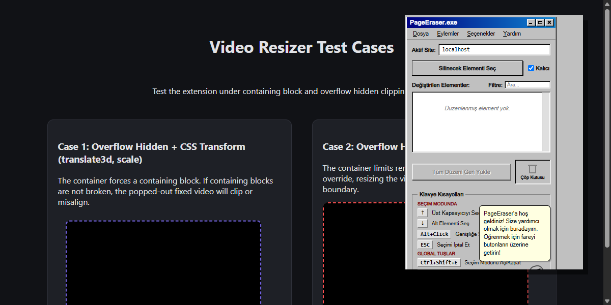
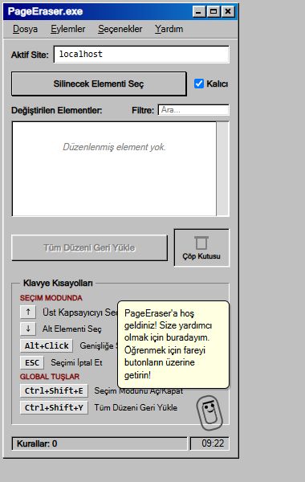
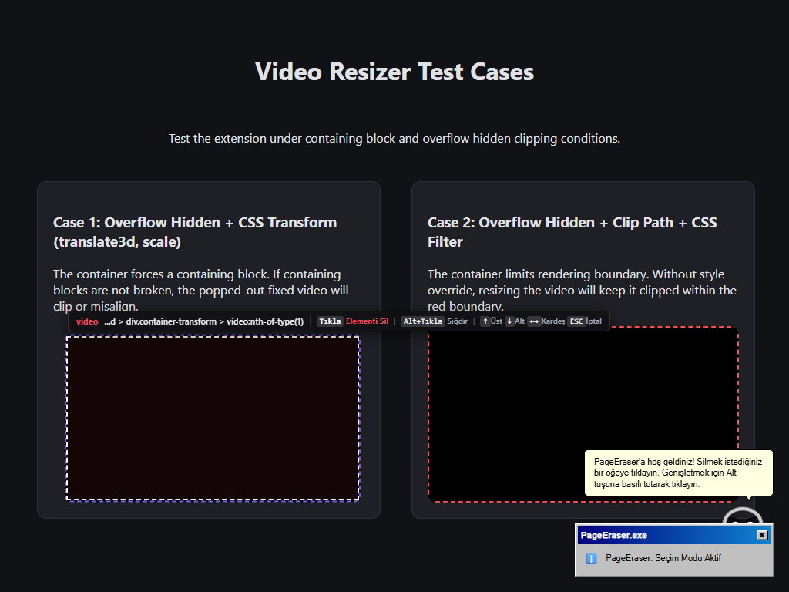
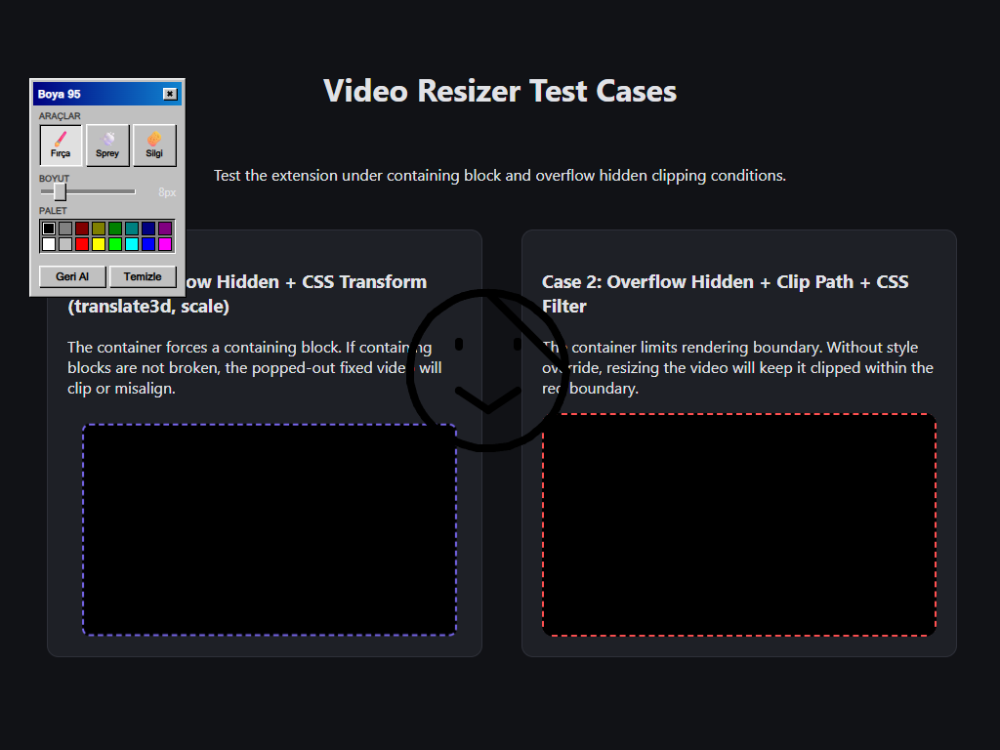
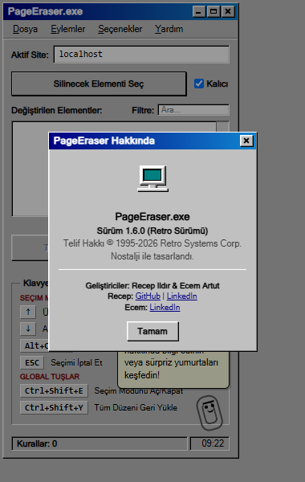

<div align="center">



<br />

# 🧹 PageEraser

**Interactively select and permanently remove any element from any webpage.**

[](https://github.com/rildir/resize-extension/actions/workflows/ci.yml)
[](https://chromewebstore.google.com/detail/maiancbfenacpjnekhdeakfbacoalkid)
[]()
[]()
[]()

*A Chrome/Edge extension wrapped in a nostalgic Windows 95 aesthetic — because cleaning up the web should be fun.*

[Website](https://rildir.github.io/resize-extension/) · [Features](#-features) · [Installation](#-installation) · [Usage](#-usage) · [Keyboard Shortcuts](#-keyboard-shortcuts) · [Architecture](docs/ARCHITECTURE.md) · [Changelog](CHANGELOG.md) · [Contributing](#-contributing)

</div>

---

## 🎬 Demo

<div align="center">


<br />
<em>Erase it once, it stays erased, even after a reload.</em>

</div>

<details>
<summary><strong>More demos: Layout X-Ray and Visual Diff</strong></summary>

<br />

<div align="center">


<em>Layout X-Ray: flex, grid and block boxes, margin and padding, and a depth slider.</em>

<br /><br />


<em>Visual Diff: overlay a design, drag the before/after divider, Compare.</em>

</div>

</details>

More on the [project website](https://rildir.github.io/resize-extension/).

---

## 📸 Screenshots

<div align="center">



<br />
<em>The main popup — a fully functional Windows 95 application window with menus, toolbars, and Clippy.</em>

</div>

<details>
<summary><strong>🖼️ More Screenshots</strong></summary>

<br />

<div align="center">



*Selection Mode — Hover any element to highlight it, click to erase, Alt+Click to stretch.*

<br />



*Paintbrush 95 — A full drawing canvas overlay with brush, spray, and eraser tools.*

<br />



*Feature Overview — Smart selection, persistent rules, DOM navigation, and more.*

</div>

</details>

---

## ✨ Features

### 🎯 Core Functionality
| Feature | Description |
|---------|------------|
| **Smart Element Selection** | Click any element to erase it with a precision crosshair cursor |
| **Eraser Wipe** | Erased elements are scraped away left to right in 350 ms (and wiped back in on restore); off under reduced-motion |
| **Stretch to Full Width** | `Alt+Click` any element to stretch it to 100% width (remove max-width constraints) |
| **Persistent Rules** | Erased elements stay hidden across page reloads and browser restarts |
| **Per-Domain Storage** | Rules are scoped per website domain with optional subdomain support |
| **CSS Selector Engine** | Automatically generates robust CSS selectors with ID/class/nth-of-type fallbacks |
| **Inline Rule Editor** | Edit CSS selectors directly from the popup for fine-tuned control |
| **Import / Export** | Backup and restore your rules as JSON files across devices |
| **Share as Code** | Copy a site's rules as one line of text and send it to anyone; they paste it under *File → Import from Code* |

### 🧭 Advanced DOM Navigation
| Key | Action |
|-----|--------|
| `↑` | Select **parent** element |
| `↓` | Select **child** element (depth-first tree traversal) |
| `←` | Select **previous sibling** |
| `→` | Select **next sibling** |
| `ESC` | Cancel selection mode |

> The `↓` key uses intelligent tree traversal: it enters the first child, and if no children exist, automatically moves to the next sibling — so you never get stuck on leaf nodes.

### 🎨 Retro Windows 95 Theme
- **Authentic Win95 UI** — Beveled borders, sunken panels, gradient title bars
- **3 Color Themes** — Classic Teal, Blue, and Plum
- **High Contrast Mode** — WCAG-compliant accessibility option
- **Large Text Mode** — Scalable typography for readability
- **Retro Toast Notifications** — Win95-style notification windows with title bars

### 🖌️ Paintbrush 95 Mode
A full-featured transparent drawing overlay on any webpage:
- **Brush Tool** — Freehand drawing with adjustable size
- **Spray Can** — Classic MS Paint spray effect
- **Eraser** — Custom cursor eraser with adjustable size
- **16-Color Palette** — Authentic MS Paint color grid
- **Undo / Clear** — Full undo history (up to 20 states)

### 🩻 Layout X-Ray
One click shows how a page is built, drawn on a single overlay that lets clicks through:
- **Colour-coded boxes** — flex orange, grid purple, block blue, inline-block green
- **Margin and padding** shaded (orange / green), **flex and grid gaps** as dashed lines
- **Hover label** — `tag.class`, size, `display`, columns and gap
- **Depth slider** (1–10, default 4) keeps big pages readable; elements off-screen are not drawn
- **Capture** saves the visible tab, overlay included, as a PNG (nothing leaves your computer)
- Start it from the toolbar button or `Alt+Shift+X`; `Esc` or the close button removes it without a trace

### 🧬 Extract to Code
Pick an element the way the eraser does, but take it with you instead of erasing it:
- **HTML** — cleaned up: scripts, iframes, `data-*`, inline handlers and unused ids are gone, links are made absolute, class names are kept
- **CSS** — only the computed properties that differ from the *browser's* defaults (measured in a blank document, so a site's own resets are not mistaken for defaults), folded into shorthands, with `::before`/`::after`, one `.pe-N` class per element
- **Tokens** — the fonts the element uses with their `@font-face` file URLs (listed, never downloaded) and its colours as a ready-to-paste `--pe-color-N` block
- Three tabs with **Copy**, plus **Copy as single HTML file**; subtrees over 500 elements are cut with a warning
- Start it from the toolbar button or `Alt+Shift+C`; `Esc` closes it without a trace

### 🎯 Visual Diff
Lay a design (a Figma export, a screenshot) over the live page and see where they disagree:
- **Load** a PNG, JPG or WebP by dropping it on the window, choosing a file or pasting it (`Ctrl+V`)
- **Align** with opacity, X/Y offset (arrow keys move 1 px, `Shift` 10 px) and scale 50–200 %; *scroll with the page* pins the design to the document, off keeps it in the window
- **Look** with *Invert*, a *Difference* blend, or a *Before / after* divider you drag: design on the left, live page on the right
- **Compare** captures the visible page (your overlay hidden), puts the design on the same pixel grid and paints every pixel that differs by more than a per-channel threshold (default 16) as a translucent red heat map, with the percentage and the number of separate regions
- The image and the alignment are remembered per site (images up to about 3.5 MB) and never leave your computer
- Start it from the toolbar button or `Alt+Shift+V`; `Esc` removes everything it added

### 📎 Clippy Assistant
- **Contextual Tips** — Clippy reacts when you hover UI elements
- **Random Tips** — Click Clippy for useful PageEraser tips
- **Wink Animation** — Animated SVG paperclip with eye tracking
- **Bilingual Support** — Clippy speaks both English and Turkish
- **Chomp Animation** — Clippy "eats" erased elements with a chomping effect

### 🔊 Retro Sound Effects
All sounds are synthesized in real-time using the **Web Audio API** — no audio files needed:
- Windows 95 startup/shutdown jingles
- Element selection & erase effects
- Clippy chomp sounds
- Minesweeper click & explosion
- Paint brush swish
- Recycle bin crumple

### 🎮 Easter Eggs
- **💣 Minesweeper** — Click the retro computer screen in the About dialog
- **💀 Blue Screen of Death** — `Ctrl+Shift+B` triggers a fake BSOD with a reset option
- **🗑️ Drag & Drop Recycle Bin** — Drag rules to the Recycle Bin to restore them

### 🌍 Internationalization
Full bilingual support with dynamic locale switching:
- 🇬🇧 **English**
- 🇹🇷 **Türkçe**

---

## 🚀 Installation

### From Source (Developer Mode)

1. **Clone the repository**
   ```bash
   git clone https://github.com/rildir/resize-extension.git
   ```

2. **Open your browser's extension page**
   - Chrome: `chrome://extensions/`
   - Edge: `edge://extensions/`

3. **Enable Developer Mode** (toggle in the top-right corner)

4. **Click "Load unpacked"** and select the cloned `PageEraser` folder

5. **Pin the extension** to your toolbar for quick access

> [!TIP]
> No build step required! The extension is written in vanilla JS and runs directly from source.

### 🌐 Interactive Web-based Live Playground
PageEraser includes built-in Chrome Extension API mocks. This allows developers and reviewers to test the entire interface, features, themes, sound effects, and drawing canvas **directly in a standard browser tab** without installing the extension:
1. Start any static web server in the project root (e.g., `npx http-server -p 8080` or VS Code Live Server).
2. Open `http://localhost:8080/test.html` in your browser.
3. Open `http://localhost:8080/popup.html` (or open it as a popup/iframe) to control the page and enjoy the full interactive experience!

---

## 🎮 Usage

### Quick Start
1. Click the **PageEraser** icon in your toolbar (or press `Ctrl+Shift+E`)
2. **Hover** over any element on the page — it highlights with a red dashed border
3. **Click** to erase it, or **Alt+Click** to stretch it to full width
4. Use **arrow keys** to navigate the DOM tree for precision selection
5. Press **ESC** to exit selection mode

### Context Menu
Right-click any element on a page to access:
- **PageEraser: Erase Element** — Instantly hide the right-clicked element
- **PageEraser: Stretch Element** — Stretch it to max width

### Managing Rules
- Open the popup to see all modified elements for the current site
- **Filter** rules by typing in the search box
- **Edit** selectors inline for fine-tuning
- **Restore** individual elements or reset the entire site
- **Delete permanently** (✕) takes a rule out of the Recycle Bin: the element stays hidden but can no longer be restored one by one. *Restore All Layout* still clears everything
- **Drag** rules to the Recycle Bin to restore them — the bin shows as full while there is something to restore
- **Import/Export** rules as JSON backups via File menu
- **Share as code**: *File → Copy Rules as Code* puts the current site's rules on your clipboard as one line (`pageeraser:1:…`). The other person opens *File → Import from Code…*, pastes it, sees which site it is for and what it holds, and presses *Add rules*. Nothing is uploaded: the code is only text, so it works in any chat or email
- **Imported rules** are listed last, under their own heading with *Keep* (they become your own) and *Remove* (all of them, one click). Rules you already had stay yours. A code cannot carry a rule that hides the whole page (however its selector is spelled), and every selector goes through the same checks as an imported backup. Backup files are limited to 2 MB, 5,000 rules per site and 20,000 in all

### Good to know
- **Keyboard:** Tab to a menu title (File, Actions, Options, Help) and press `Enter`, `Space` or `↓`; `↑` `↓` move, `←` `→` change menu, `Esc` closes. `Alt` plus the underlined letter opens a menu too
- **Frames:** the picker works on the page itself. An element inside an `<iframe>` (most ad slots) cannot be picked directly; select the `<iframe>` with the arrow keys and erase that
- **Storage:** rules and the Visual Diff design image share the browser's 10 MB of extension storage. If it is full, PageEraser tells you the rule could not be saved instead of pretending it was

---

## ⌨️ Keyboard Shortcuts

### Global Shortcuts
| Shortcut | Action |
|----------|--------|
| `Alt+Shift+E` | Toggle Selection Mode (`Ctrl+Shift+E` also works while the page has focus) |
| `Alt+Shift+D` | Restore All Layout on this site (`Ctrl+Shift+Y` also works while the page has focus) |
| `Alt+Shift+W` | Start Paintbrush 95 (`Ctrl+Shift+K` also works while the page has focus) |
| `Alt+Shift+X` | Toggle Layout X-Ray (`Ctrl+Shift+X` also works while the page has focus) |
| `Alt+Shift+V` | Toggle Visual Diff (works while the page has focus; no default browser-wide key, assign one at `chrome://extensions/shortcuts`) |
| `Alt+Shift+C` | Toggle Extract to Code (works while the page has focus; for a browser-wide key assign one at `chrome://extensions/shortcuts` — Chrome allows only four default shortcuts per extension and they are taken) |
| `Ctrl+Z` | Undo last erased element (on page) |

**Browser-wide keys.** `E`, `D`, `W` and `X` are registered with Chrome, so they work
from anywhere in the browser. Some recent Chrome versions (seen on 140 and 153; not on
102, 114 or 125) leave `Alt+Shift+W` and `Alt+Shift+X` unassigned when an extension is
installed. If one does nothing while the page is not in focus, assign it at
`chrome://extensions/shortcuts`. With the page in focus every shortcut above works
regardless, because the extension also listens for them itself (not inside text fields).

### In Selection Mode
| Key | Action |
|-----|--------|
| `Click` | Erase highlighted element |
| `Alt+Click` | Stretch element to full width |
| `↑` | Select parent container |
| `↓` | Navigate down (child → sibling → parent's sibling) |
| `←` | Previous sibling element |
| `→` | Next sibling element |
| `ESC` | Cancel selection mode |

---

## 🏗️ Tech Stack

| Technology | Usage |
|-----------|-------|
| **Manifest V3** | Latest Chrome extension architecture |
| **Vanilla JavaScript** | Zero dependencies, no frameworks |
| **Web Audio API** | Real-time synthesized retro sound effects |
| **CSS3** | Advanced animations, transitions, and theming |
| **Chrome Storage API** | Persistent per-domain rule storage (10MB local) |
| **Chrome Context Menus API** | Right-click integration |
| **Chrome Commands API** | Global keyboard shortcuts |

---

## 📁 Project Structure

```
resize-extension/
├── manifest.json          # Extension manifest (V3)
├── background.js          # Service worker — commands, context menus, badges
├── content.js             # Content script — selection, erasing, DOM navigation
├── content.css            # Injected styles — highlighter, tooltips, toasts, clippy
├── popup.html             # Popup UI — Windows 95 themed interface
├── popup.css              # Popup styles — complete Win95 design system
├── popup.js               # Popup logic — rules management, theming, menus
├── shared.js              # Shared helpers — domain scoping, selector validation
├── audio.js               # Sound synthesizer — Web Audio API retro effects
├── locales.js             # i18n — English & Turkish translations
├── clippy.js              # Clippy assistant — contextual tips & animations
├── tour.js                # Onboarding — 3-step guided spotlight tour
├── minesweeper.js         # Easter egg — classic Minesweeper game
├── privacy-policy.html    # In-extension privacy policy (linked from About)
├── build.ps1              # Packages a store-ready ZIP (dev files excluded)
├── tests/run.js           # Test suite — no browser, no dependencies
├── docs/ARCHITECTURE.md   # Design decisions, threat model, trade-offs
├── .github/workflows/     # CI — tests, syntax check, packaged artifact
├── test.html              # Development test page with edge-case scenarios
├── mock-chrome.js         # Chrome extension API mocks for playground mode
├── icons/                 # Extension icons (16, 48, 128px)
│   ├── icon16.png
│   ├── icon48.png
│   └── icon128.png
└── screenshots/           # README assets
    ├── hero-banner.png
    ├── selection-mode.png
    ├── popup-window.png
    ├── paint-mode.png
    └── features-overview.png
```

---

## 🤝 Contributing

Contributions are welcome! Here's how to get started:

1. **Fork** the repository
2. **Create** a feature branch (`git checkout -b feature/amazing-feature`)
3. **Commit** your changes (`git commit -m 'Add amazing feature'`)
4. **Push** to the branch (`git push origin feature/amazing-feature`)
5. **Open** a Pull Request

### Development

```bash
# Clone the repo
git clone https://github.com/rildir/resize-extension.git

# Load as unpacked extension in Chrome
# No build step needed for development — edit and reload!

# Test with the included test page
# Open test.html in browser with the extension loaded

# Run the test suite (selector validation, domain scoping, popup wiring)
node tests/run.js

# Package a store-ready ZIP into dist/ (development files excluded)
powershell -ExecutionPolicy Bypass -File build.ps1
```

> [!NOTE]
> The extension is built with **zero dependencies**. Just clone and load — no `npm install` required.
> `tests/run.js` and `build.ps1` need only Node and PowerShell, both already on a Windows dev machine.

> [!IMPORTANT]
> Always upload the ZIP produced by `build.ps1`, never a zip of the repository.
> `test.html`, `mock-chrome.js`, `screenshots/` and this README must not ship —
> every extra file is one more thing a store reviewer has to read and rule out.

---

## 👨‍💻 Authors

<table>
  <tr>
    <td align="center">
      <strong>Recep Ildır</strong><br/>
      <a href="https://github.com/rildir">GitHub</a> ·
      <a href="https://www.linkedin.com/in/recep-ildir/">LinkedIn</a>
    </td>
    <td align="center">
      <strong>Ecem Artut</strong><br/>
      <a href="https://www.linkedin.com/in/ecemartut/">LinkedIn</a>
    </td>
  </tr>
</table>

---

## 📄 License

This project is licensed under the **MIT License** — see the [LICENSE](LICENSE) file for details.

---

<div align="center">

<sub>Built with ❤️ and a healthy dose of 90s nostalgia.</sub>

<br />

**⭐ Star this repo if you found it useful!**

</div>
