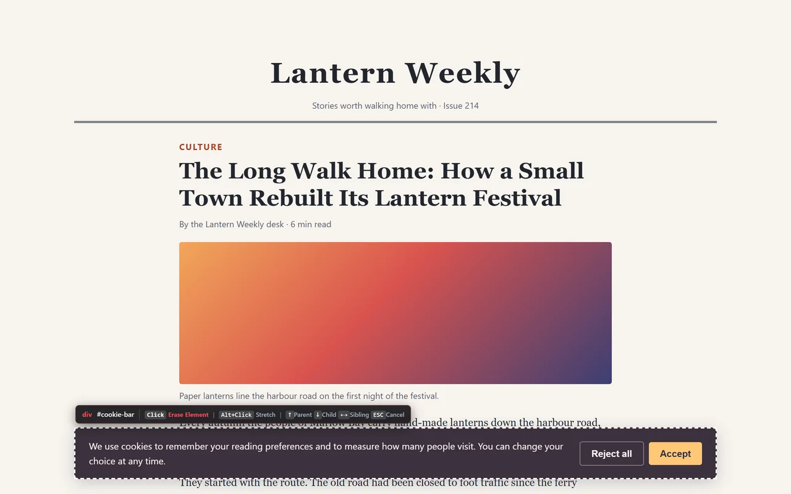
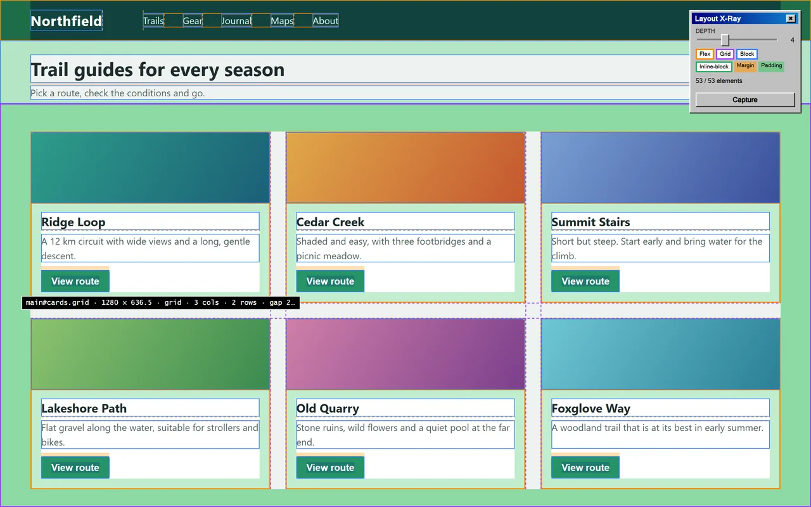
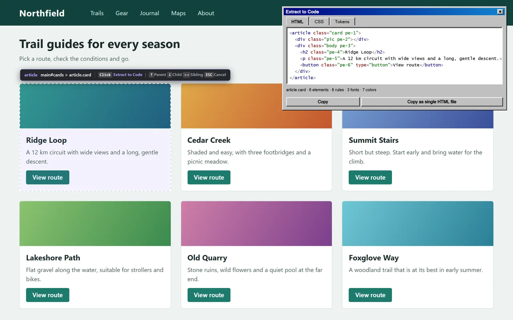
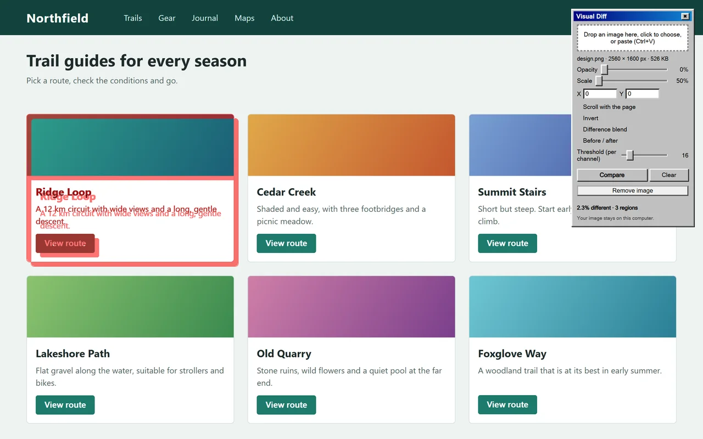
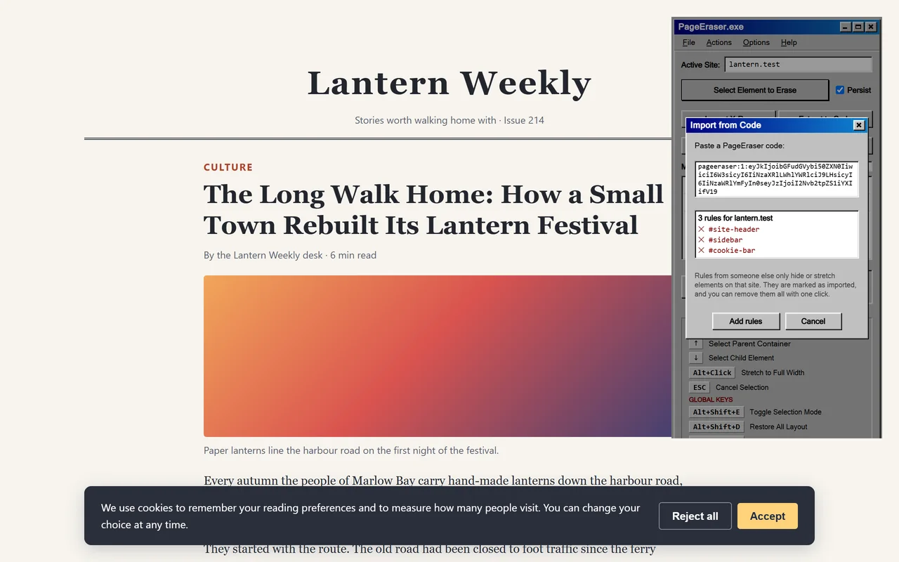

<div align="center">

# PageEraser

**Erase any element from any web page, and keep it erased.**

A free Chrome extension. No account, no tracking, and everything stays on your device.

[Install from the Chrome Web Store](https://chromewebstore.google.com/detail/maiancbfenacpjnekhdeakfbacoalkid) ·
[Website](https://rildir.github.io/resize-extension/) ·
[Changelog](CHANGELOG.md) ·
[Privacy policy](https://rildir.github.io/resize-extension/privacy-policy.html)

[](https://github.com/rildir/resize-extension/actions/workflows/ci.yml)


[](LICENSE)

<br />


</div>

---

## Overview

PageEraser lets you pick any element on a page and hide it. The rule is saved for that site and applied again every time the page loads, so a cookie bar, a sticky header or a pop-up you have dismissed once stays dismissed.

The same element picker drives three tools for people who build web pages:

- **Layout X-Ray** draws how a page is laid out.
- **Extract to Code** copies a component as HTML, CSS and design tokens.
- **Visual Diff** overlays a design on the live page and marks the pixels that differ.

PageEraser runs entirely in your browser. Rules and settings live in the extension's own storage, and the extension makes no network requests of its own.

## Features

### Erase and stretch

Hover an element to outline it, click to hide it, or `Alt`+click to stretch it to full width. The arrow keys move the selection through the page's element tree, so you can choose exactly the container you mean.

- Rules are stored per site (optionally including subdomains) and re-applied on every load
- Selectors are generated from IDs and classes, with `nth-of-type` as a fallback, and can be edited in place
- Undo right after an erase, restore single rules, or restore a whole site
- Export and import rules as JSON, or share a site's rules as one line of text
- Right-click menu entries for *Erase Element* and *Stretch Element*

<p align="center"></p>

### Layout X-Ray

One click draws the layout over the page on a single overlay that lets clicks through.

- Boxes are colour-coded: flex, grid, block and inline-block
- Margin and padding are shaded, and flex and grid gaps are drawn as dashed lines
- Hovering an element shows its tag, size, `display`, columns and gap
- A depth slider (1 to 10, default 4) keeps large pages readable
- *Capture* saves the visible tab, overlay included, as a PNG. Nothing leaves your computer

<p align="center"></p>

### Extract to Code

Pick an element the way the eraser does, but copy it instead of hiding it.

- **HTML:** cleaned up. Scripts, iframes, `data-*` attributes, inline handlers and unused ids are removed, links are made absolute, and class names are kept
- **CSS:** only the computed properties that differ from the browser's defaults (measured in a blank document, so a site's own resets are not mistaken for defaults), folded into shorthands, including `::before` and `::after`
- **Tokens:** the fonts the element uses, with their `@font-face` file URLs (listed, never downloaded), and its colours as a ready-to-paste `--pe-color-N` block
- Copy each tab, or copy everything as a single HTML file. Subtrees over 500 elements are cut, with a warning

<p align="center"></p>

### Visual Diff

Lay a design (a Figma export, a screenshot) over the live page and see where the two disagree.

- Load a PNG, JPG or WebP by dropping it on the window, choosing a file or pasting it with `Ctrl+V`
- Align it with opacity, X/Y offset (arrow keys move 1 px, `Shift` 10 px) and scale from 50 to 200 %. *Scroll with the page* pins the design to the document
- Compare visually with *Invert*, a *Difference* blend, or a *Before / after* divider you drag
- *Compare* captures the visible page with your overlay hidden, puts the design on the same pixel grid and paints every pixel that differs by more than a per-channel threshold (default 16) as a translucent red heat map, with the percentage and the number of separate regions
- The image and its alignment are remembered per site (images up to about 3.5 MB) and never leave your computer

<p align="center"></p>

### Share rules as code

*File → Copy Rules as Code* puts the current site's rules on the clipboard as a single line (`pageeraser:1:…`). The recipient opens *File → Import from Code*, pastes it, sees which site it is for and what it contains, and presses *Add rules*. Nothing is uploaded; the code is plain text and works in any chat or email.

Imported rules are listed under their own heading, with *Keep* and *Remove*. A code can only hide or stretch elements, it cannot carry a rule that hides the whole page, and every selector passes the same checks as an imported backup file.

<p align="center"></p>

### Interface and accessibility

The interface is a Windows 95-style application window, deliberately. It has three colour themes (Classic Teal, Blue, Plum), a high-contrast mode, a large-text mode, English and Turkish, and menus that work from the keyboard. Paintbrush 95 (draw on a page), the Clippy assistant, synthesized sound effects (Web Audio API, no audio files) and a few easter eggs are included and can be switched off.

## Installation

**From the Chrome Web Store:** [add PageEraser](https://chromewebstore.google.com/detail/maiancbfenacpjnekhdeakfbacoalkid) and pin it to the toolbar. Other Chromium-based browsers can usually install it from the same page.

**From source:**

1. Clone the repository:
   ```bash
   git clone https://github.com/rildir/resize-extension.git
   ```
2. Open `chrome://extensions/` and switch on **Developer mode**.
3. Choose **Load unpacked** and select the cloned folder.

There is no build step and no dependency to install.

## Usage

1. Click the PageEraser icon in the toolbar, or press `Alt+Shift+E`.
2. Hover an element. It is outlined.
3. Click to erase it, or `Alt`+click to stretch it to full width. Use the arrow keys to move the selection, and `Esc` to cancel.

### Managing rules

Open the popup to see every change made on the current site. You can filter the list, edit a selector, restore a rule, or restore the whole site with *Restore All Layout*. Dragging a rule onto the Recycle Bin restores it. The ✕ button removes a rule from the bin for good: the element stays hidden but can no longer be restored one by one. Rules can be backed up and restored from the *File* menu. Backup files are limited to 2 MB, 5,000 rules per site and 20,000 in total.

### Good to know

- **Keyboard:** Tab to a menu title (File, Actions, Options, Help) and press `Enter`, `Space` or `↓`. `↑` `↓` move, `←` `→` change menu and `Esc` closes. `Alt` plus the underlined letter opens a menu too.
- **Frames:** the picker works on the page itself. An element inside an `<iframe>` (most ad slots) cannot be picked directly. Select the `<iframe>` with the arrow keys and erase that.
- **Storage:** rules and the Visual Diff image share the browser's 10 MB of extension storage. If it is full, PageEraser says the rule could not be saved instead of pretending it was.

## Keyboard shortcuts

| Shortcut | Action |
|---|---|
| `Alt+Shift+E` | Toggle selection mode (`Ctrl+Shift+E` also works while the page has focus) |
| `Alt+Shift+D` | Restore all layout changes on this site (`Ctrl+Shift+Y` also works while the page has focus) |
| `Alt+Shift+W` | Start Paintbrush 95 (`Ctrl+Shift+K` also works while the page has focus) |
| `Alt+Shift+X` | Toggle Layout X-Ray (`Ctrl+Shift+X` also works while the page has focus) |
| `Alt+Shift+V` | Toggle Visual Diff (works while the page has focus; for a browser-wide key, assign one at `chrome://extensions/shortcuts`) |
| `Alt+Shift+C` | Toggle Extract to Code (works while the page has focus; for a browser-wide key, assign one at `chrome://extensions/shortcuts`) |
| `Ctrl+Z` | Undo the last erased element (on the page) |

Chrome allows only four default shortcuts per extension, so `E`, `D`, `W` and `X` are registered with the browser and work from anywhere. Some recent Chrome versions (seen on 140 and 153, not on 102, 114 or 125) leave `Alt+Shift+W` and `Alt+Shift+X` unassigned after installation. If one does nothing while the page is not in focus, assign it at `chrome://extensions/shortcuts`. With the page in focus every shortcut works regardless, because the extension also listens for them itself (not inside text fields).

**In selection mode**

| Key | Action |
|---|---|
| `Click` | Erase the highlighted element |
| `Alt+Click` | Stretch the element to full width |
| `↑` | Select the parent container |
| `↓` | Move down (child, then sibling, then the parent's sibling) |
| `←` `→` | Previous or next sibling |
| `Esc` | Cancel selection mode |

## Privacy and permissions

PageEraser collects no personal data, has no analytics and makes no network requests of its own. Rules and settings are kept in the browser's extension storage on your device, and uninstalling the extension removes them.

| Permission | Why it is needed |
|---|---|
| `storage` | Saves your rules, settings and Visual Diff image locally |
| `activeTab` | Lets a tool work on the current tab after you start it, including the screenshot behind Capture and Compare |
| `contextMenus` | Adds *Erase Element* and *Stretch Element* to the right-click menu |

The content script runs on the pages you visit so that your saved rules apply as soon as a page loads. It reads a page only to do what you asked and keeps or sends none of it. PageEraser does not request the `tabs`, `history`, `cookies`, `downloads`, `clipboardRead`, `webRequest` or `identity` permissions. The full text is in the [privacy policy](https://rildir.github.io/resize-extension/privacy-policy.html).

## Development

```bash
# Run the test suite (selector validation, domain scoping, popup wiring); Node only
node tests/run.js

# Package a store-ready ZIP into dist/ (development files are excluded)
powershell -ExecutionPolicy Bypass -File build.ps1
```

The extension is written in vanilla JavaScript on Manifest V3 and has no runtime or build dependencies. `tests/run.js` and `build.ps1` need only Node and PowerShell. CI (`.github/workflows/ci.yml`) runs a syntax check, the tests and the packaging on every push and pull request.

To try the interface without installing the extension, serve the project root with any static server and open `test.html` and `popup.html`; `mock-chrome.js` provides the Chrome APIs.

```
manifest.json        Extension manifest (Manifest V3)
background.js        Service worker: commands, context menus, badge
content.js           Content script: selection, erasing, rule application
content.css          Styles injected into pages
modes/               Layout X-Ray, Extract to Code and Visual Diff
popup.html .css .js  The popup window: rules, menus, themes
shared.js            Domain scoping, selector validation, rule sharing
locales.js           English and Turkish strings
privacy-policy.html  Privacy policy, linked from the About dialog
build.ps1            Packages the store ZIP
tests/run.js         Test suite (no browser, no dependencies)
docs/ARCHITECTURE.md Design decisions, threat model, trade-offs
index.html, assets/  Project website (GitHub Pages) and its media
```

> [!IMPORTANT]
> Always upload the ZIP produced by `build.ps1`, never a zip of the repository. `test.html`, `mock-chrome.js`, `index.html`, `assets/`, `docs/` and this README must not ship: every extra file is one more thing a store reviewer has to read and rule out.

See [docs/ARCHITECTURE.md](docs/ARCHITECTURE.md) for the design decisions and [CHANGELOG.md](CHANGELOG.md) for the release history.

## Contributing

Bug reports and pull requests are welcome. Please [open an issue](https://github.com/rildir/resize-extension/issues) first for anything larger than a small fix, and run `node tests/run.js` before sending a pull request.

## Authors

<table>
  <tr>
    <td align="center">
      <strong>Recep Ildır</strong><br/>
      <a href="https://github.com/rildir">GitHub</a> ·
      <a href="https://www.linkedin.com/in/recep-ildir/">LinkedIn</a>
    </td>
    <td align="center">
      <strong>Ecem Artut</strong><br/>
      <a href="https://www.linkedin.com/in/ecemartut/">LinkedIn</a>
    </td>
  </tr>
</table>

## License

Released under the [MIT License](LICENSE).
